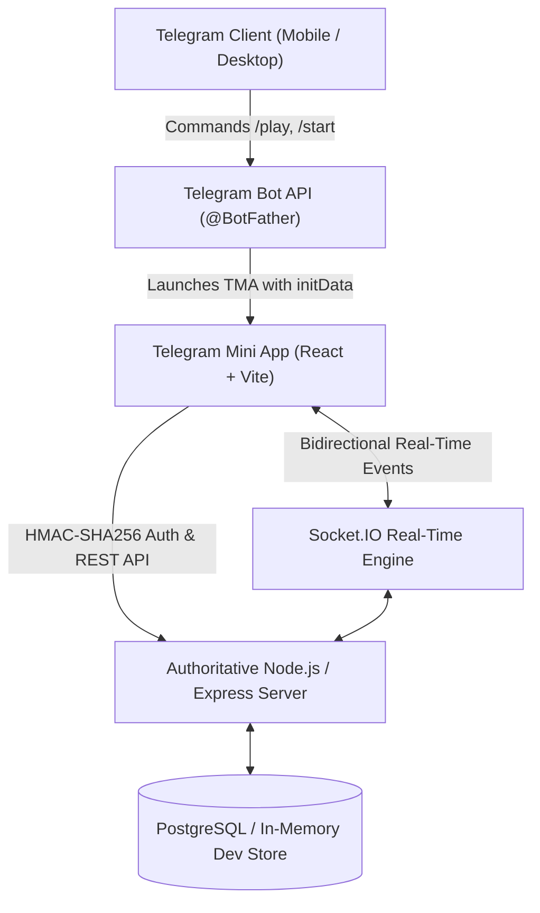

# 🎲 Ludo Arena — Telegram Multiplayer Gaming Platform

**Ludo Arena** is an authoritative, real-time multiplayer Ludo platform integrated directly into Telegram via the Telegram Mini Apps SDK and Telegram Bot API. It features 2–4 player matches, authoritative server-side game mechanics, real-time spectator lounges with live synchronized boards, and room-scoped live chat with emoji reactions.

---

## 🏗️ Architecture & Technology Stack



### Technology Highlights
- **Frontend:** React 19, Vite, Tailwind CSS / Custom Gaming Theme, `@twa-dev/sdk`, `socket.io-client`.
- **Backend:** Node.js 24, Express.js, Socket.IO 4, `node-telegram-bot-api`, `pg` (PostgreSQL), `helmet`, `express-rate-limit`.
- **Database:** PostgreSQL schema with UUID keys, relational indexes, and migrations. Automatic fallback to high-speed in-memory store for instant local testing without pre-configured PostgreSQL.
- **Authoritative Game Engine:** Server generates all dice rolls (1–6), validates turn ownership, detects all legitimate moves, executes captures, checks safe tiles, handles 6-roll bonuses, and detects victory conditions.

---

## 📁 Repository Structure

```
d:\ludo bot anaya\
├── client/                     # Telegram Mini App Frontend (React + Vite)
│   ├── src/
│   │   ├── components/         # ChatPanel, UI modals
│   │   ├── constants/          # Game styling, board paths & event definitions
│   │   ├── context/            # AppContext (Telegram initData auth & state)
│   │   ├── game/               # LudoBoard (15x15 authoritative grid), DiceComponent
│   │   ├── pages/              # Home, CreateMatch, JoinMatch, Lobby, Game, Spectate, Profile, Leaderboard, Settings, Admin
│   │   ├── services/           # REST API client with header authentication
│   │   └── socket/             # Socket.IO connection manager
│   ├── index.html              # Telegram WebApp SDK inclusion
│   └── vite.config.js          # Reverse proxy config for dev
├── server/                     # Authoritative Backend (Node.js + Express)
│   ├── src/
│   │   ├── bot/                # Telegram bot commands (/start, /play, /profile, /spectate, etc.)
│   │   ├── database/           # PostgreSQL pool, migrations, and dev memory adapter
│   │   │   └── migrations/     # 001_core_tables.sql schema
│   │   ├── game/               # ludoEngine.js (authoritative rules & state transitions)
│   │   ├── middleware/         # auth.js (Telegram initData crypto verification)
│   │   ├── routes/             # REST controllers (auth, matches, users, leaderboard, admin, chat)
│   │   ├── services/           # matchService.js (room lifecycle & database sync)
│   │   ├── socket/             # socketManager.js (real-time rooms, dice, tokens, spectators, chat)
│   │   └── index.js            # Express app & HTTP/Socket server bootstrap
│   └── test/                   # Automated validation suite (ludo.test.js)
├── shared/                     # Shared constants & TypeScript definitions
│   ├── constants/              # Shared game rules & event enums
│   └── types/                  # JSDoc type contracts
├── .env.example                # Template for environment variables
└── README.md                   # Full documentation & deployment guides
```

---

## ⚡ Quick Start (Local Development)

### Prerequisites
- Node.js 18+ (Node 24 tested)
- npm 9+

### 1. Configure Environment Variables
Copy `.env.example` in both server and client:
```bash
# In server/
copy .env.example .env
```
*(If `DATABASE_URL` is omitted, the server automatically boots an in-memory database store for local testing).*

### 2. Run Backend Server
```bash
cd server
npm install
node src/index.js
```
*Server starts on `http://localhost:3001` with Socket.IO enabled.*

### 3. Run Frontend Client
In a separate terminal:
```bash
cd client
npm install
npm run dev
```
*Client starts on `http://localhost:5173`.*

### 4. Run Test Suite
```bash
cd server
node test/ludo.test.js
```

---

## 🤖 Telegram Bot Configuration

1. Open Telegram and message **[@BotFather](https://t.me/BotFather)**.
2. Send `/newbot` and follow the prompts to choose a bot name and username (e.g. `LudoArenaBot`).
3. Copy the HTTP API token provided by BotFather and set it as `TELEGRAM_BOT_TOKEN` in your server `.env`.
4. Configure the Web App URL:
   - Send `/newapp` to BotFather.
   - Choose your bot.
   - Provide a title and description.
   - Set the Web App URL to your deployed client URL (or ngrok URL for local development: `https://your-domain.ngrok-free.app`).
   - Set the short name (e.g. `play`).
5. Register bot menu commands with BotFather (`/setcommands`):
   ```text
   start - Launch Ludo Arena & welcome menu
   play - Open Ludo Arena Mini App
   profile - View your win rate, level & XP
   leaderboard - Check top ranking players
   matches - Browse active game lobbies
   spectate - Watch live ongoing matches
   history - View your recent match history
   settings - Configure sound, vibration & rules
   help - How to play and rules of Ludo
   ```

---

## 🌐 Production Deployment

### Option A: Render (Recommended for quick deployment)

#### 1. Backend Web Service
1. Connect your Git repository on [Render](https://render.com).
2. Create a **Web Service**:
   - **Root Directory:** `server`
   - **Build Command:** `npm install`
   - **Start Command:** `node src/index.js`
   - **Environment Variables:**
     - `NODE_ENV`: `production`
     - `PORT`: `10000`
     - `DATABASE_URL`: `postgres://...` (Render Managed PostgreSQL connection string)
     - `TELEGRAM_BOT_TOKEN`: `your-bot-token-from-botfather`
     - `CLIENT_URL`: `https://your-frontend.onrender.com`

#### 2. Frontend Static Site
1. Create a **Static Site** on Render:
   - **Root Directory:** `client`
   - **Build Command:** `npm install && npm run build`
   - **Publish Directory:** `dist`
   - **Environment Variables:**
     - `VITE_SERVER_URL`: `https://your-backend.onrender.com`

---

### Option B: AWS (EC2 + RDS PostgreSQL)

1. **RDS PostgreSQL:**
   - Launch a PostgreSQL db.t3.micro/small instance with PostgreSQL 15+.
   - Add a security group rule allowing inbound port 5432 from your EC2 security group.
2. **EC2 Instance (Ubuntu 22.04 LTS):**
   - Install Node.js 20/22 and PM2:
     ```bash
     curl -fsSL https://deb.nodesource.com/setup_20.x | sudo -E bash -
     sudo apt-get install -y nodejs nginx
     sudo npm install -g pm2
     ```
   - Clone project and build client:
     ```bash
     cd /var/www/ludo-arena/client && npm install && npm run build
     cd /var/www/ludo-arena/server && npm install
     ```
   - Start backend with PM2:
     ```bash
     pm2 start src/index.js --name "ludo-server"
     pm2 startup && pm2 save
     ```
   - Configure Nginx reverse proxy:
     - Route `/api` and `/socket.io` to `http://127.0.0.1:3001` with WebSocket upgrade headers.
     - Serve static files from `/var/www/ludo-arena/client/dist` for root `/`.

---

## 🔒 Security & Verification

- **Authoritative Logic:** The client emits only intention events (`roll_dice`, `move_token`). The server generates all random dice rolls and performs rigorous validation:
  - Validates turn ownership.
  - Verifies token status (cannot move from base without rolling a 6).
  - Checks board bounds and exact home stretch calculations.
  - Disallows moves during other players' turns.
- **Telegram initData Verification:** The server uses HMAC-SHA256 hashing with your Telegram bot token to verify incoming `x-telegram-init-data` headers. No client-spoofed Telegram user IDs are ever accepted.
- **Rate Limiting & Anti-Spam:** Express rate limiting prevents API abuse, and chat message throttling limits players to 1 message every 2 seconds.

